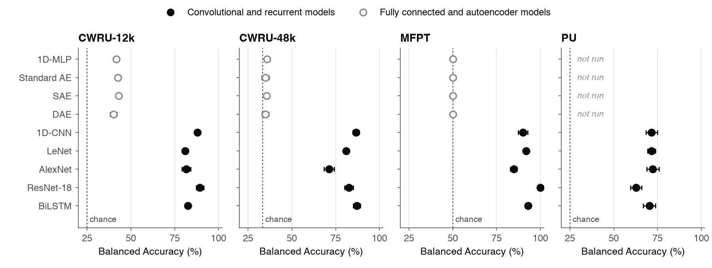
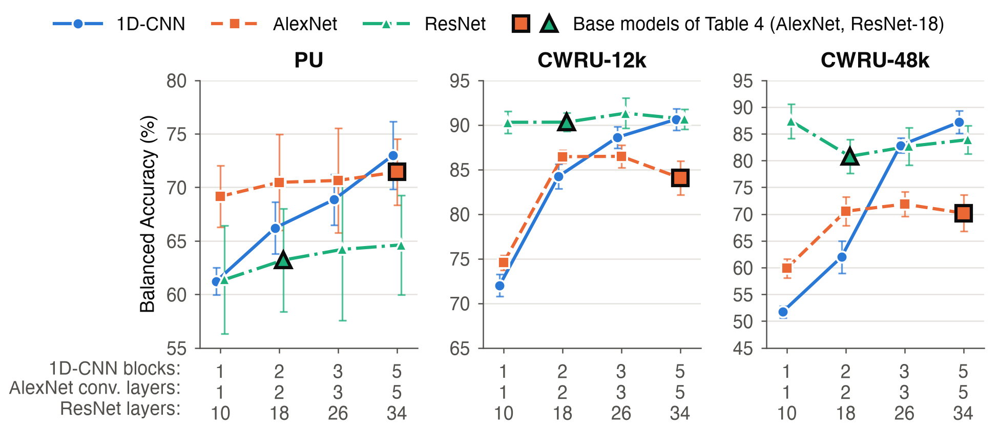
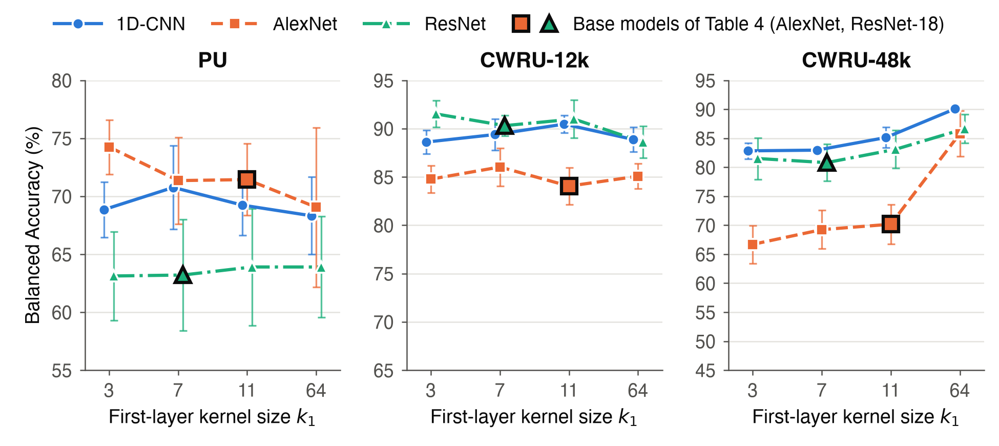
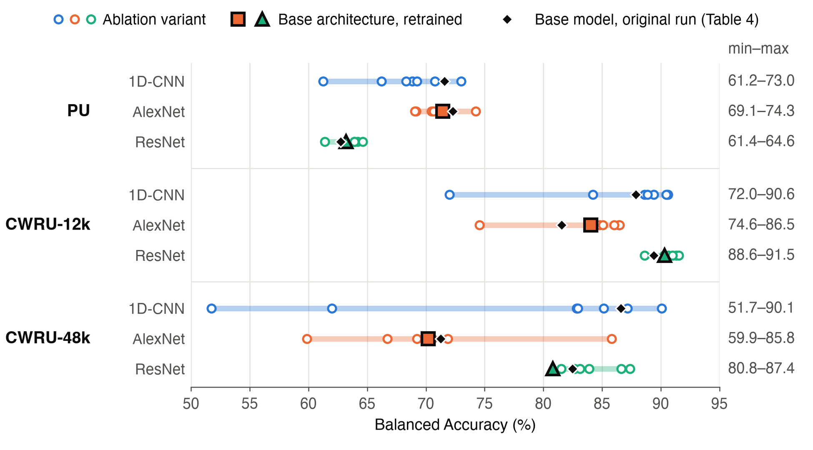

# Depth Is Not a Reliable Predictor of Generalization

Code and results for the paper **"Depth Is Not a Reliable Predictor of Generalization: A
Similarity-Bias-Free Reassessment of Deep Learning for Vibration-Based Fault Diagnosis"**
([paper]([PAPER LINK]), DOI: [DOI]).

The paper benchmarks deep-learning architectures for **intelligent fault diagnosis** (IFD) of
rolling bearings under a **similarity-bias-free** protocol. A random split puts windows of the
same recording in both training and test sets. Here, every test fold holds out whole
acquisition groups instead: motor load for CWRU, operating condition for PU, fault type and load
for MFPT. A model therefore has to generalise to a condition it never saw, rather than to
another window of a recording it already memorised.

The repository has two parts:

- **Benchmark**: nine 1D architectures evaluated with the unbiased protocol (Table 4 of the
  paper). The code covers six datasets and two protocols, 108 experiments in total. The paper
  reports the multi-round protocol on four of the datasets.
- **Controlled ablation**: depth and first-layer kernel size varied one at a time within three
  architecture families (Tables 5–6 and Figures 1–3 of the paper), 63 experiments.

All the numbers in the paper can be traced to the JSON files in [`results/`](results/).

---

## Results

### Benchmark (Table 4)

Balanced Accuracy (B.Acc) and Macro F1-Score (F1) in %, mean over all folds ± standard deviation
across the 8 rounds (MFPT: 5 rounds of 7 folds). Best per column in bold.

| Model | CWRU-12k B.Acc | CWRU-12k F1 | CWRU-48k B.Acc | CWRU-48k F1 | MFPT B.Acc | MFPT F1 | PU B.Acc | PU F1 |
|---|---:|---:|---:|---:|---:|---:|---:|---:|
| 1D-MLP | 41.57 ± 0.89 | 39.89 ± 1.01 | 35.80 ± 1.21 | 29.05 ± 1.01 | 50.00 ± 0.00 | 33.33 ± 0.00 | — | — |
| Standard AE | 42.66 ± 0.87 | 41.05 ± 0.95 | 34.97 ± 2.29 | 28.95 ± 1.96 | 50.00 ± 0.00 | 33.33 ± 0.00 | — | — |
| SAE | 43.03 ± 0.86 | 41.44 ± 0.85 | 35.51 ± 1.11 | 31.33 ± 1.72 | 50.00 ± 0.00 | 33.33 ± 0.00 | — | — |
| DAE | 40.05 ± 1.96 | 34.71 ± 2.13 | 34.93 ± 2.01 | 27.95 ± 2.80 | 50.00 ± 0.00 | 33.33 ± 0.00 | — | — |
| 1D-CNN | 87.86 ± 1.28 | 87.49 ± 1.34 | 86.59 ± 1.72 | **87.04 ± 1.65** | 90.00 ± 2.78 | 87.61 ± 3.69 | 71.56 ± 3.28 | **68.92 ± 3.76** |
| LeNet | 80.96 ± 1.55 | 80.70 ± 1.53 | 81.07 ± 0.99 | 80.19 ± 1.41 | 91.90 ± 1.17 | 89.50 ± 1.20 | 71.54 ± 2.35 | 68.00 ± 2.62 |
| AlexNet | 81.57 ± 2.54 | 81.28 ± 2.65 | 71.25 ± 2.87 | 70.36 ± 3.29 | 84.76 ± 1.90 | 80.83 ± 3.20 | **72.30 ± 3.55** | 68.84 ± 4.93 |
| ResNet-18 | **89.40 ± 2.15** | **88.61 ± 2.40** | 82.46 ± 2.49 | 81.99 ± 2.38 | **100.00 ± 0.00** | **100.00 ± 0.00** | 62.73 ± 3.08 | 57.88 ± 4.89 |
| BiLSTM | 82.47 ± 1.58 | 81.93 ± 1.75 | **87.16 ± 2.04** | 86.23 ± 2.34 | 92.86 ± 0.00 | 90.48 ± 0.00 | 70.38 ± 3.50 | 66.21 ± 4.43 |



- **Removing similarity bias exposes a large, architecture-dependent generalisation gap.** The
  literature reports near-perfect accuracies on these datasets under random splits.
- **The fully connected and autoencoder models collapse.** They reach 34–43% on CWRU and
  exactly 50.00% on the binary MFPT, which is a single class predicted for every instance in
  every fold. Unsupervised pre-training (plain, sparse or denoising) does not change that. They
  were not run on PU.
- **Convolutional and recurrent models transfer across conditions, but unevenly.** ResNet-18 is
  the best model on CWRU-12k and MFPT, yet the worst on PU, where the shallower AlexNet is the
  best.
- **PU is the most challenging dataset.** No model, and no ablation variant, exceeds 75%
  Balanced Accuracy on it. MFPT is saturated even without similarity bias.

### Controlled ablation (Tables 5–6, Figures 1–3)

The AlexNet versus ResNet-18 reversal on PU cannot be attributed to depth, because the two
networks differ in several ways at once. The ablation varies **one** factor at a time within
three families:

- **Depth arm**: four depths at a fixed first-layer kernel size *k*₁.
- **Kernel arm**: four first-layer kernel sizes (*k*₁ = 3, 7, 11, 64) at a fixed depth.

The two arms share one configuration, so each family has 4 + 4 − 1 = 7 variants. In AlexNet and
ResNet-18 the shared configuration is exactly the base model of Table 4. 3 families × 7
variants × 3 datasets (PU, CWRU-12k, CWRU-48k) = **63 experiments**. With 8 rounds × 4 folds
each, that is 2,016 training runs. Every experiment uses the same folds and seed as Table 4.
Adjacent levels are compared with paired Wilcoxon tests (Holm-corrected), and each arm with
Page's trend test.







Balanced Accuracy (%) of every variant. D = depth arm, K = kernel arm, D/K = shared configuration.
† marks an architecture identical to a base model of Table 4, retrained. Best per dataset in bold.

| Family | Arm | Depth | k₁ | Params (M) | PU | CWRU-12k | CWRU-48k |
|---|---|---:|---:|---:|---:|---:|---:|
| 1D-CNN | D | 1 | 3 | 0.034 | 61.23 ± 1.26 | 71.99 ± 1.23 | 51.73 ± 1.08 |
| 1D-CNN | D | 2 | 3 | 0.068 | 66.21 ± 2.43 | 84.22 ± 1.37 | 61.99 ± 3.03 |
| 1D-CNN | D/K | 3 | 3 | 0.140 | 68.85 ± 2.38 | 88.60 ± 1.22 | 82.83 ± 1.37 |
| 1D-CNN | D | 5 | 3 | 0.657 | 72.99 ± 3.16 | 90.62 ± 1.22 | 87.18 ± 2.10 |
| 1D-CNN | K | 3 | 7 | 0.140 | 70.76 ± 3.62 | 89.39 ± 1.62 | 82.95 ± 0.73 |
| 1D-CNN | K | 3 | 11 | 0.140 | 69.24 ± 2.63 | 90.46 ± 0.91 | 85.13 ± 1.76 |
| 1D-CNN | K | 3 | 64 | 0.141 | 68.32 ± 3.34 | 88.88 ± 1.28 | **90.07 ± 0.54** |
| AlexNet | D | 1 | 11 | 1.449 | 69.16 ± 2.86 | 74.56 ± 0.83 | 59.87 ± 1.79 |
| AlexNet | D | 2 | 11 | 2.297 | 70.47 ± 4.49 | 86.43 ± 0.73 | 70.53 ± 2.67 |
| AlexNet | D | 3 | 11 | 3.698 | 70.64 ± 4.89 | 86.48 ± 1.27 | 71.86 ± 2.28 |
| AlexNet | D/K † | 5 | 11 | 3.404 | 71.44 ± 3.10 | 84.05 ± 1.90 | 70.18 ± 3.39 |
| AlexNet | K | 5 | 3 | 3.403 | **74.25 ± 2.34** | 84.77 ± 1.39 | 66.70 ± 3.28 |
| AlexNet | K | 5 | 7 | 3.403 | 71.35 ± 3.73 | 86.02 ± 1.96 | 69.24 ± 3.31 |
| AlexNet | K | 5 | 64 | 3.407 | 69.05 ± 6.88 | 85.07 ± 1.30 | 85.81 ± 3.91 |
| ResNet | D | 10 | 7 | 1.753 | 61.38 ± 5.07 | 90.29 ± 1.23 | 87.39 ± 3.21 |
| ResNet | D/K † | 18 | 7 | 3.846 | 63.21 ± 4.81 | 90.30 ± 1.04 | 80.79 ± 3.19 |
| ResNet | D | 26 | 7 | 5.939 | 64.20 ± 6.65 | 91.31 ± 1.69 | 82.65 ± 3.50 |
| ResNet | D | 34 | 7 | 8.032 | 64.62 ± 4.64 | 90.65 ± 1.13 | 83.90 ± 2.64 |
| ResNet | K | 18 | 3 | 3.846 | 63.12 ± 3.82 | **91.52 ± 1.38** | 81.51 ± 3.58 |
| ResNet | K | 18 | 11 | 3.846 | 63.90 ± 5.05 | 90.99 ± 1.97 | 83.10 ± 3.25 |
| ResNet | K | 18 | 64 | 3.850 | 63.90 ± 4.35 | 88.61 ± 1.66 | 86.65 ± 2.51 |

What the ablation shows:

- **The effect of depth depends on the family and on the dataset.** More depth improved the
  1D-CNN on all three datasets, with every adjacent step significant. It did not necessarily
  improve AlexNet or ResNet. On CWRU-48k, for example, ResNet-10 beat ResNet-18 by 6.6 pp. On PU
  all three families show an increasing trend with depth (modest for AlexNet and ResNet), so
  depth did not cause overfitting there.
- **A larger first kernel is not what makes AlexNet better on PU.** It helped all three families
  on CWRU-48k only. On PU it helped none, and AlexNet got worse as the kernel grew: its
  *k*₁ = 3 variant reached 74.25%, the best PU result of the whole study.
- **AlexNet's advantage over ResNet on PU persists** at every matched kernel size (by 5.2 to
  11.1 pp). It also persists when the single-layer AlexNet is compared with the 34-layer ResNet.
  It therefore comes from other family-level differences, not from depth or the first-layer
  receptive field.
- **The best family depends on the dataset**: AlexNet on PU, ResNet on CWRU-12k, and the
  1D-CNN on CWRU-48k.

Machine-readable versions of all three tables, including the significance tests of Table 6, are
in [`results/tables/`](results/tables/). [`results/README.md`](results/README.md) maps every table
and figure of the paper to its source files.

---

## Repository layout

```
run_experiments.py           entry point: the 108 benchmark experiments
run_experiments_ablation.py  entry point: the 63 ablation experiments (see Ablations)

src/                         the benchmark, shared by both entry points
├── registry.py              the 108 experiments (+ experiments.json)
├── datasets.py              the 6 datasets: download, transform, grouping, resampling
├── folds.py                 unbiased folds, single and multi round (+ fold_designs.json)
├── models.py                the 9 architectures
├── experiment.py            DeepLearningExperiment: cross validation and training loop
└── serialize.py             results -> JSON

ablation/                    only what the ablations add on top of src/
├── models.py                parametric 1D-CNN, AlexNet and ResNet-18: depth and first kernel as arguments
├── registry.py              the 63 ablation experiments + their JSON document
└── report.py                ablation results -> tables and significance tests

results/                     every result reported in the paper (see results/README.md)
├── benchmark/               the 108 benchmark experiments, extracted from the original notebooks
├── ablation/                the 63 ablation experiments + report.md / report.tex / report.json
├── tables/                  Tables 4, 5 and 6 of the paper as CSV
└── figures/                 the figures of this README (PNG) and of the paper (PDF)

v0_experiments/              the twelve original Colab notebooks + the script that extracts their results
runs/                        output of new benchmark runs (git-ignored, created on first run)
data/                        raw downloads and converted datasets (git-ignored, created on first run)
pyproject.toml, uv.lock      dependencies (managed with uv)
```

`ablation/` reuses `src/` untouched (same datasets, folds, training loop and result
serialisation), so ablation numbers are directly comparable with the benchmark.

The benchmark started as twelve Colab notebooks, archived unchanged in `v0_experiments/`.
`run_experiments.py` is their script form: same datasets, same folds, same architectures, same
hyperparameters. The hyperparameters are *not* uniform: `pretrain_epochs` is 50 for some
datasets and 100 for others, and `multi_round/PU` trains ResNet18 with `batch_size=128` for 25
epochs. `results/benchmark/` holds the results parsed out of the notebook cell outputs, in the
same JSON schema the script writes, so old and new runs can be compared field by field.

---

## Install

[uv](https://docs.astral.sh/uv/) is the recommended way; resolving and installing torch and
the rest takes seconds instead of minutes. From the repository root:

```bash
# If you don't have uv installed
pip install uv

# Create .venv with the locked dependencies (pyproject.toml + uv.lock)
uv sync

# Activate the virtual environment
source .venv/bin/activate  # or `.venv\Scripts\activate` on Windows
```

`gdown<5` is not optional: `vibdata==1.1.1` calls `gdown.cached_download(..., md5=...)`, and
gdown 5 removed that argument, so every raw download fails with
`TypeError: download() got an unexpected keyword argument 'md5'`.

Tested on Python 3.12. The ablation ran with torch 2.14 on CUDA and torch 2.13 on Apple
Silicon (MPS).

## Run

There are two entry points. They share the same flag vocabulary and the same result schema:

| Script | Runs | Writes to |
|---|---|---|
| `run_experiments.py` | the 108 benchmark experiments | `runs/benchmark/` |
| `run_experiments_ablation.py` | the 63 ablation experiments | `results/ablation/` |

New benchmark runs go to `runs/benchmark/`, so they never mix with the archived notebook results
in `results/benchmark/`. The ablation runner writes to `results/ablation/`, where its results are
tracked: `--resume` and `--report` work on them directly.

Both read and write the same `data/` directory, so a dataset downloaded by one is reused by
the other. This section documents the benchmark runner; the ablation runner has its own
section under [Ablations](#ablations).

With the environment activated:

```bash
python run_experiments.py --all --resume --keep-going
```

`uv run python run_experiments.py ...` works too, and uses `./.venv` without
activating anything.

### Choosing what runs

Three selection filters, all repeatable. Passing a filter more than once *widens* the
selection along that dimension; different filters *narrow* each other:

| Filter | Accepted values |
|---|---|
| `--suite` | `single_round`, `multi_round` |
| `--dataset` | `CWRU12k`, `CWRU48k`, `IMS`, `MFPT`, `PU`, `UOC` |
| `--model` | `mlp1d`, `ae1d`, `sae1d`, `dae1d`, `cnn1d`, `lenet1d`, `resnet18`, `alexnet`, `bilstm` |

Passing no filter is the same as `--all`. `--list` prints the resulting selection and exits
without training. It is always worth running first:

```bash
# 108 rows: everything
python run_experiments.py --all --list

# 18 rows: two models, every dataset, both protocols
python run_experiments.py --model resnet18 --model alexnet --list
```

### Common commands

```bash
# The full grid, resumable and fault-tolerant. This is the main command.
#   --resume     skips experiments whose result JSON already exists
#   --keep-going carries on to the next experiment when one raises
python run_experiments.py --all --resume --keep-going

# The same thing detached, keeping a transcript. Results are written per experiment,
# so you can tail run.out or runs/benchmark/run.log and stop it at any point.
nohup python run_experiments.py --all --resume --keep-going > run.out 2>&1 &

# One notebook's worth of work: nine models on one dataset under one protocol.
# The dataset is loaded and converted once and shared by all nine.
python run_experiments.py --suite single_round --dataset CWRU12k

# A single experiment, cut down so it finishes in seconds. Use this to check the
# environment before committing to a long run; the overrides are recorded in the
# result JSON under run.overrides so a smoke result is never mistaken for a real one.
python run_experiments.py --suite single_round --dataset UOC \
    --model cnn1d --epochs 2 --max-rounds 1

# Fill in only what is missing after an interrupted run, without re-reading anything.
python run_experiments.py --all --resume --no-download
```

Raw datasets are downloaded on first use into `data/` and converted once per dataset, so the
first run touching a given dataset is much slower than the rest.

### Flags

**Selection**

| Flag | Default | Notes |
|---|---|---|
| `--all` | — | run everything; same as passing no filter |
| `--suite`, `--dataset`, `--model` | all | repeatable selection filters (see above) |
| `--list` | off | print the selection and exit without training |

**Paths**

| Flag | Default | Notes |
|---|---|---|
| `--data-root` | `data/` | raw downloads, converted datasets, group/fold caches |
| `--output-dir` | `runs/benchmark/` | result JSONs, `index.json`, `run_manifest.json` |
| `--artifacts-dir` | `<output-dir>/_artifacts` | per-fold loss curves and `.pt` checkpoints |
| `--log-file` | `<output-dir>/run.log` | full transcript, appended |
| `--no-download` | off | fail instead of downloading a missing dataset |

**Execution**

| Flag | Default | Notes |
|---|---|---|
| `--device` | auto-detected | `cuda`, `cuda:N`, `mps` or `cpu`; see [Devices](#devices) |
| `--seed` | `42` | seeds python/numpy/torch, the validation split and the weight init |
| `--resume` | off | skip experiments whose result JSON already exists |
| `--keep-going` | off | carry on when one experiment raises; failures land in `run_manifest.json` |
| `--no-artifacts` | off | skip loss curves and checkpoints (much less disk) |
| `--folds-source` | `notebook` | `notebook` rebuilds the folds from the recorded design; `generate` runs the real combination search; see [Fold design](#fold-design) |

**Overrides**, for smoke tests only. Each one is recorded in the result JSON under
`run.overrides`, so a shortened run is always identifiable.

| Flag | Overrides |
|---|---|
| `--epochs` | `num_epochs` |
| `--pretrain-epochs` | `pretrain_epochs` (autoencoders only) |
| `--batch-size` | `batch_size` |
| `--max-rounds` | number of rounds executed in a multiround experiment |

### Devices

Both runners detect the training device on startup and pick the fastest backend torch can
actually use, preferring **CUDA → MPS → CPU**. The choice, and what else was available, is
logged and recorded in every result JSON under `run.environment`:

```
[2026-08-27 22:26:14] device: mps auto-detected -- Apple Silicon GPU (Metal Performance
                      Shaders) (also available: cpu)
```

Override with `--device cuda`, `--device cuda:1`, `--device mps` or `--device cpu`. A request
the machine cannot satisfy fails immediately with a clear message instead of dying inside the
first fold:

```
--device 'cuda': torch reports no usable 'cuda' backend on this machine. Available: mps, cpu.
```

Two things to know about **MPS** (Apple Silicon). Results can differ marginally from CPU or
CUDA because the Metal kernels are not bit-identical; this is normal for any accelerator change
and does not affect conclusions. And if an unsupported operator ever aborts a run, relaunch
with `PYTORCH_ENABLE_MPS_FALLBACK=1` set, which routes those ops to the CPU.

One known exception is the benchmark's **`AlexNet1D`**. On torch 2.13, MPS implements
`AdaptiveAvgPool1d` only when the input length is a multiple of the output size
(pytorch/pytorch#96056). AlexNet reaches its `AdaptiveAvgPool1d(6)` with an odd length on
CWRU12k, CWRU48k and PU, so it fails in the first fold, and `PYTORCH_ENABLE_MPS_FALLBACK=1`
does not help. Run those experiments with `--device cpu` or on CUDA. The ablation's AlexNet
variants work around this; see [Ablations](#ablations).

### Resuming, logs and failures

Progress goes to stdout **and** to `<output-dir>/run.log`, so a backgrounded run keeps a full
transcript. Results are written per experiment, not at the end, so `--resume` picks up exactly
where it stopped, including after a crash or a `Ctrl-C`. Every run also writes
`run_manifest.json` listing what was executed, skipped and failed, plus the exact command,
seed, device and package versions.

The exit code is `1` if any experiment failed, `0` otherwise.

## Result files

```
runs/benchmark/                                   (results/benchmark/ has the same layout)
├── index.json                                    every experiment, one row each
├── run_manifest.json                             what this run did: args, env, failures
├── run.log
├── _artifacts/<suite>/<DATASET>/<experiment>/    loss curves + model checkpoints
└── <suite>/<DATASET>/
    ├── _index.json
    └── <experiment_name>.json
```

Each experiment JSON:

| Key | Contents |
|---|---|
| `experiment_name`, `dataset`, `suite`, `protocol`, `model`, `description` | identity |
| `source` | the v0 notebook it corresponds to |
| `run` | timestamps, duration, seed, device, fold source, overrides, package versions |
| `configuration` | `batch_size`, `lr`, `num_epochs`, `pretrain_epochs`, sparsity/reconstruction settings, `input_length`, `num_classes` |
| `results.summary` | mean/std of accuracy and F1 |
| `results.per_fold_metrics` | accuracy, F1, precision, recall, roc_auc per fold |
| `results.confusion_matrix` | pooled matrix, overall accuracy, sample count |
| `results.folds_training_log` | per fold: per-fold confusion matrix and **every** epoch (`train_loss`, `val_loss`, `time_seconds`; plus `recon_loss` for the autoencoders) |
| `results.fold_errors` | present only when a fold failed |

Multiround experiments replace `folds_training_log` with `rounds[]`, each round carrying its
own summary, per-fold metrics, confusion matrix and training logs, plus a `fold_design`
describing the round × fold group assignment.

`results/benchmark/` uses the same schema, so a new run can be diffed against the notebook
numbers directly. The archived files have no `run` block, and their training history only has
every fifth epoch, because that is all the notebooks printed.

Two things to know when reading a number. Per-fold `accuracy` is `balanced_accuracy_score`,
while the pooled "overall accuracy" of the confusion matrix is the raw one, so the two differ.
And there is no early stopping or checkpoint selection: 20% of each training fold is held out
only to log the validation loss, and the model tested is the one from the last epoch, as
described in Section 2.2 of the paper.

---

## Ablations

`run_experiments_ablation.py` runs the controlled ablation of the paper (Section 4.2). It
addresses two objections raised in review. First, the AlexNet vs. ResNet-18 comparison cannot
isolate depth, because the two differ in kernels, receptive fields, pooling, parameter count
and skip connections at once. Second, the receptive-field explanation had never been tested.
Both are answered by varying **one** axis at a time *inside* a model family (the paper's own
1D-CNN, AlexNet and ResNet-18), and then checking whether a trend found in one family repeats
in the others.

### The grid

Every family runs the same two arms. Variants are named `d<depth>_k<first kernel>`, with depth
counted in the family's own unit; the shared configuration (bold) belongs to both arms.

| Family (`--model`) | Depth arm | Kernel arm | Shared configuration |
|---|---|---|---|
| `cnn1d` | `d1_k3`, `d2_k3`, **`d3_k3`**, `d5_k3` (conv blocks) | **`d3_k3`**, `d3_k7`, `d3_k11`, `d3_k64` | `d3_k3` |
| `alexnet` | `d1_k11`, `d2_k11`, `d3_k11`, **`d5_k11`** (conv layers) | `d5_k3`, `d5_k7`, **`d5_k11`**, `d5_k64` | `d5_k11` = base AlexNet |
| `resnet18` | `d10_k7`, **`d18_k7`**, `d26_k7`, `d34_k7` (weighted layers) | `d18_k3`, **`d18_k7`**, `d18_k11`, `d18_k64` | `d18_k7` = base ResNet-18 |

Because the shared configuration is in both arms, each family has 7 distinct variants, not 8.
Each variant is trained once and reported in both arms. 3 families × 7 variants × 3 datasets
(PU, CWRU12k, CWRU48k) = **63 experiments**, each 8 rounds × 4 folds. The same key can name
different networks in different families (`d5_k3` and `d3_k11` exist in both `cnn1d` and
`alexnet`). Result files are prefixed by the family, so they never collide.

What each family holds fixed:

- **`cnn1d`**: every kernel after the first is 3, channel widths are 16→32→64→128→256, and
  padding, BatchNorm, pooling strategy, dropout and the head are identical throughout. `d3_k3`
  is `src/models.py`'s `CNN1D` with its 7-5-3 kernel schedule flattened to 3-3-3, so no 1D-CNN
  variant is the base 1D-CNN of Table 4. The block structure is otherwise identical, including
  the `AdaptiveMaxPool1d(16)` that replaces the last block's `MaxPool1d(2)`.
- **`alexnet`** is `AlexNet1D` truncated to its first *d* conv layers, with the stem kernel as
  a parameter. Widths are 64-192-384-256-256, later kernels 5-3-3-3, and `MaxPool1d(3, 2)`
  follows conv 1, conv 2 and the last conv. Stem stride 4 and padding 2, no BatchNorm,
  `AdaptiveAvgPool1d(6)` and the 1024-1024 dropout head are as in the base model.
- **`resnet18`** is `ResNet18` with *n* BasicBlocks in each of its four stages (depth =
  2 + 8n: ResNet-10/18/26/34), with the stem kernel as a parameter. Stage widths
  64-128-256-512, the three stride-2 stages, the stem, skip connections, initialisation and
  the head are as in the base model. Blocks are uniform across stages, so "ResNet-34" here is
  `[4, 4, 4, 4]` rather than the canonical `[3, 4, 6, 3]`: same depth, but the arm varies a
  single number.

The shared configurations of AlexNet and ResNet-18 *are* `AlexNet1D` / `ResNet18`, module for
module and with the same initial weights under the same seed, so they can be read against
Table 4.

| Family | Variant | Depth | First kernel | Params | Receptive field |
|---|---|---|---|---|---|
| `cnn1d` | `d1_k3` | 1 | 3 | 33,508 | 3 |
| | `d2_k3` | 2 | 3 | 67,908 | 8 |
| | `d3_k3` | 3 | 3 | 139,780 | 18 |
| | `d5_k3` | 5 | 3 | 657,028 | 78 |
| | `d3_k7` | 3 | 7 | 139,844 | 22 |
| | `d3_k11` | 3 | 11 | 139,908 | 26 |
| | `d3_k64` | 3 | 64 | 140,756 | 79 |
| `alexnet` | `d1_k11` | 1 | 11 | 1,448,708 | 19 |
| | `d2_k11` | 2 | 11 | 2,296,772 | 67 |
| | `d3_k11` | 3 | 11 | 3,697,988 | 131 |
| | `d5_k11` | 5 | 11 | 3,403,588 | 195 |
| | `d5_k3` | 5 | 3 | 3,403,076 | 187 |
| | `d5_k7` | 5 | 7 | 3,403,332 | 191 |
| | `d5_k64` | 5 | 64 | 3,406,980 | 248 |
| `resnet18` | `d10_k7` | 10 | 7 | 1,753,156 | 195 |
| | `d18_k7` | 18 | 7 | 3,845,956 | 435 |
| | `d26_k7` | 26 | 7 | 5,938,756 | 675 |
| | `d34_k7` | 34 | 7 | 8,031,556 | 915 |
| | `d18_k3` | 18 | 3 | 3,845,700 | 431 |
| | `d18_k11` | 18 | 11 | 3,846,212 | 439 |
| | `d18_k64` | 18 | 64 | 3,849,604 | 492 |

Parameters are for 4 classes. The receptive field is the theoretical one of the convolutional
stack, in input samples. It follows the longest path, so it runs through both convolutions of
every ResNet block, and it excludes the final adaptive pool.

How cleanly each arm isolates its axis, as recorded in every result JSON:

- **The kernel arm is close to a clean manipulation in all three families**: parameter count
  moves by less than 1%. The range it covers differs, though. Kernel 3 → 64 multiplies the
  1D-CNN's receptive field by 4.4×, but AlexNet's only by 1.3× and ResNet-18's by 1.1×, because
  their strided stacks already reach far beyond the first kernel.
- **No depth arm can hold parameters constant**, since adding layers adds weights. ResNet's is
  the cleanest: widths, downsampling and head are fixed, and parameters grow 4.6×. The 1D-CNN's
  grows 20×, because each block also widens the flattened head. AlexNet's is not even
  monotonic (3.70M at depth 3 > 3.40M at depth 5), because the head input is 6 × the last
  conv's width. These confounds are measured (`architecture.num_parameters`) rather than
  hidden. `cnn1d` `d5_k3` vs `d3_k64` is a useful cross-arm reading: near-identical receptive
  field (78 vs 79) with 4.7× the parameters.
- **Initial vs. whole-stack receptive field.** The base ResNet-18 has a larger theoretical
  receptive field (435) than the base AlexNet (195). AlexNet only has the larger *first* kernel
  (11 vs 7). The kernel arm tests the first-kernel version of the claim.
- AlexNet `d5_k3` uses a stem kernel smaller than the stem stride (3 < 4), so its first layer
  skips one input sample in four. That is part of what the variant measures, and its
  description in the JSON says so.

### Training protocol

Each family trains exactly as its base model does on each dataset. The folds are the same
unbiased multiround folds, the optimizer is Adam, and batch size, learning rate and epochs are
read from that row in `src/experiments.json`: lr 3e-4, batch 64 and 100 epochs everywhere,
except **ResNet-18 on PU, which uses batch 128 and 25 epochs**, as in Table 4. Within an arm
the training configuration is identical, so only the architecture changes. The training loop
is the same `DeepLearningExperiment`: a 20% validation split for logging only, **no early
stopping**, and the last epoch's model is tested. Both facts are recorded in every result JSON
under `configuration.val_split`, `configuration.early_stopping` and `notes.protocol`.

### Selecting variants

Same idea as the benchmark runner:

| Filter | Accepted values | Notes |
|---|---|---|
| `--model` | `cnn1d`, `alexnet`, `resnet18` | repeatable; without it, all three families |
| `--dataset` | `PU`, `CWRU12k`, `CWRU48k` | repeatable |
| `--study` | `depth`, `kernel` | selects a whole arm; **either arm includes the family's shared configuration** |
| `--variant` | `cnn1d`: `d1_k3` `d2_k3` `d3_k3` `d5_k3` `d3_k7` `d3_k11` `d3_k64`<br>`alexnet`: `d1_k11` `d2_k11` `d3_k11` `d5_k11` `d5_k3` `d5_k7` `d5_k64`<br>`resnet18`: `d10_k7` `d18_k7` `d26_k7` `d34_k7` `d18_k3` `d18_k11` `d18_k64` | repeatable; matched in every selected family, so combine with `--model` for `d5_k3` and `d3_k11` |

All filters intersect, so `--model alexnet --study depth --variant d5_k11` runs just the
AlexNet shared configuration on each dataset. Passing none runs all 63.

### Commands

```bash
# Rebuild report.md / report.tex / report.json from the results in results/ablation/,
# without training anything.
python run_experiments_ablation.py --report

# Check a selection before spending compute. Prints dataset, family, variant, arm, depth,
# first kernel, batch size and epochs for each experiment, then exits.
python run_experiments_ablation.py --all --list

# Reproduce the whole grid in a separate directory (the tracked results stay untouched).
python run_experiments_ablation.py --all --keep-going --output-dir runs/ablation

# One family on one dataset (7 experiments), or one arm of it (4 experiments).
python run_experiments_ablation.py --model cnn1d --dataset PU --output-dir runs/ablation
python run_experiments_ablation.py --model cnn1d --dataset PU --study depth --output-dir runs/ablation

# Smoke test: one variant, 2 epochs, 1 round, in a scratch directory so --resume never
# mistakes it for a finished result. The overrides are recorded in run.overrides.
python run_experiments_ablation.py --model cnn1d --dataset CWRU12k --variant d1_k3 \
    --epochs 2 --max-rounds 1 --output-dir /tmp/ablation_smoke
```

With the default `--output-dir` (`results/ablation/`), `--resume` skips every variant already
there, and a run without `--resume` overwrites the tracked results. Keep smoke tests out of
it: a 2-epoch result written there counts as done, and `--resume` would then skip the real run.

### Flags that differ

Everything from the benchmark runner's [Flags](#flags) applies unchanged: `--data-root`,
`--output-dir`, `--artifacts-dir`, `--log-file`, `--no-download`, `--device`, `--seed`,
`--resume`, `--keep-going`, `--no-artifacts`, `--folds-source`, `--epochs`, `--batch-size`,
`--max-rounds`. The differences:

| Flag | Default | Notes |
|---|---|---|
| `--model` | all three | selects a model *family* (`cnn1d`, `alexnet`, `resnet18`), not one network |
| `--variant`, `--study` | — | replace the benchmark's per-model selection; see above |
| `--output-dir` | `results/ablation/` | not `runs/benchmark/`; keep them apart |
| `--epochs`, `--batch-size`, `--max-rounds` | — | the only overrides; there is no `--pretrain-epochs` because no ablation variant pre-trains |
| `--report` | off | rebuild the report from `--output-dir` and exit without training |

Device detection is identical to the benchmark runner (CUDA, then MPS, then CPU; see
[Devices](#devices)). The AlexNet variants run on MPS even though the benchmark's `AlexNet1D`
does not: their adaptive average pool switches to an equivalent matmul only on MPS and only
when the input length is not a multiple of 6. Everywhere else it is the native op.

`--data-root` defaults to the same `data/` as the benchmark, so nothing is downloaded twice.

### Compute

The 63 experiments of the paper ran on two machines, as recorded in each JSON under
`run.environment`:

| Experiments | Device | Wall time |
|---|---|---|
| 1D-CNN depth arm on PU (4) | Apple M4, 16 GB, MPS (torch 2.13) | 114.5 h |
| the other 59 | NVIDIA A100 80 GB, CUDA (torch 2.14) | 78.2 h |

Memory at the protocol's batch size (parameters + Adam state + activations) decides where
ResNet-18 can run:

| Variant | PU (batch 128) | CWRU48k (batch 64) | CWRU12k (batch 64) |
|---|---|---|---|
| ResNet-10 `d10_k7` | 12.4 GB | 4.7 GB | 1.2 GB |
| ResNet-18 `d18_k7` | 19.4 GB | 7.4 GB | 1.8 GB |
| ResNet-26 `d26_k7` | 26.4 GB | 10.1 GB | 2.5 GB |
| ResNet-34 `d34_k7` | 33.4 GB | 12.8 GB | 3.2 GB |
| any AlexNet | ≤ 2.6 GB | ≤ 2.0 GB | ≤ 0.6 GB |

On a 16 GB Mac, ResNet on PU swaps until it stalls, so run the ResNet variants on a CUDA GPU:
about 40 GB for `d26_k7` and `d34_k7` on PU, while a 24 GB card holds `d10_k7` and `d18_k7`.
AlexNet and the 1D-CNN fit anywhere, but they are much slower on MPS than on CUDA.

### Output

`results/ablation/` mirrors the benchmark layout one level flatter (no suite directory), with
an extra top-level `architecture` block per experiment and `family`/`study`/`variant` fields:

```
results/ablation/
├── index.json                               every variant, one row each, with params and RF
├── report.md                                tables + significance tests, for reading
├── report.tex                               the same tables as booktabs
├── report.json                              the same numbers, machine readable
├── run_manifest.json, run.log               written by a run (git-ignored)
├── _artifacts/<DATASET>/<experiment>/       loss curves + model checkpoints (git-ignored)
└── <DATASET>/
    ├── _index.json
    └── <family>_ablation_<variant>_<dataset>.json   e.g. alexnet_ablation_d3_k11_pu.json
```

Each experiment JSON is the benchmark schema plus:

| Key | Contents |
|---|---|
| `family`, `study`, `variant` | the model family (`cnn1d`, `alexnet`, `resnet18`), which arm the variant belongs to (`depth`, `kernel` or `both`) and its name. 1D-CNN results written before `family` existed carry it in `suite` (`cnn1d_ablation`), which the report understands |
| `source` | the review comment it answers (`R2.2` depth, `R2.3` kernel) and the benchmark experiment to compare against |
| `architecture` | depth, first kernel, parameter counts (total, conv, head), theoretical receptive field in samples and seconds, plus per family: kernels and channels per block (`cnn1d`, `alexnet`), stem stride/padding and max-pool count (`alexnet`), blocks per stage and stage widths (`resnet18`) |
| `configuration` | adds `optimizer`, `loss`, `val_split`, `early_stopping`, `checkpoint_selection` |
| `notes` | why the protocol and the model's structure are what they are |

### Reading the report

The report is regenerated at the end of every run, and by `--report` alone. It is organised
dataset → family → arm, and each dataset opens with a **cross-model summary**: one table per
arm, one row per family, with balanced accuracy at each level, the best variant and the trend
statistics. It is the table that answers whether a trend repeats across architectures. Each row
is a within-family test; nothing is tested *across* families, because their variants are
different networks. Per family and per arm it then gives:

- **Mean ± std** of Balanced Accuracy and Macro F1, under *both* dispersion conventions: std
  over all 32 per-fold scores, and std over the 8 round means (the convention of the paper's
  tables and of `results.summary`).
- **Adjacent paired Wilcoxon** tests between neighbouring variants, paired by `(round, fold)`
  and Holm-corrected within the arm. Pairing is legitimate because every variant sees the
  identical fold assignment with the identical seed.
- **Page's trend test** across the whole arm, run in both directions. This is the test that
  actually addresses "monotonic in depth", which adjacent pairwise tests do not.
- **Spearman ρ** against depth or kernel size, for effect direction and magnitude.

An arm with fewer than two finished variants is left out, and a partial arm is flagged with the
variants it is missing, so the report can be built at any point of a run.

---

## Protocol

**Datasets and grouping.** Every test fold holds out whole acquisition groups. The paper uses
CWRU 12k, CWRU 48k, MFPT and PU. IMS and UOC are part of the code and of
[`results/benchmark/`](results/benchmark/), but not of the paper.

| Dataset | Classes | Grouped by | Folds |
|---|---|---|---|
| CWRU 12k | 4 | motor load (0–3 hp) | 4 |
| CWRU 48k | 3 | motor load (0–3 hp) | 4 |
| IMS | 7 | test rig and bearing | 3 |
| MFPT | 2 | fault type and load, binned | 3 (single round) / 7 (multi round) |
| PU | 4 | rotation speed, load torque, radial force | 4 |
| UOC | 5 | fault severity | 5 |

**Architectures**, four of them with an unsupervised pre-training phase:

| Model key | Class | Pre-training |
|---|---|---|
| `mlp1d` | `MLP1D` | — |
| `ae1d` | `AE1D` | autoencoder |
| `sae1d` | `SAE1D` | sparse autoencoder (KL penalty) |
| `dae1d` | `DAE1D` | denoising autoencoder |
| `cnn1d` | `CNN1D` | — |
| `lenet1d` | `LeNet1D` | — |
| `resnet18` | `ResNet18` | — |
| `alexnet` | `AlexNet1D` | — |
| `bilstm` | `BiLSTM` | — |

2 protocols × 6 datasets × 9 models = **108 experiments**.

### Fold design

`--folds-source notebook` (default) rebuilds the multiround folds from the round × fold design
printed by the v0 notebooks, stored in `src/fold_designs.json`. It is instant and gives exactly
the folds behind the archived numbers.

`--folds-source generate` runs `FoldIdxGeneratorUnbiased.compute_combinations` for real. It is
correct but materialises `list(combinations(...))` first. For CWRU12k and PU that is
C(256, 4) = 174,792,640 tuples, roughly 15 GB of RAM.

IMS and UOC have no multiround design: their `multi_round_experiments/` notebooks use
`folds_singleround_deep`, so those 18 entries run single round and say so in `notes`.

---

## Citation

If you use this code or these results, please cite the paper:

```bibtex
@article{[CITATION KEY],
  title   = {Depth Is Not a Reliable Predictor of Generalization: A Similarity-Bias-Free
             Reassessment of Deep Learning for Vibration-Based Fault Diagnosis},
  author  = {[AUTHORS]},
  journal = {Knowledge-Based Systems},
  year    = {[YEAR]},
  volume  = {[VOLUME]},
  pages   = {[ARTICLE NUMBER]},
  doi     = {[DOI]}
}
```

GitHub's "Cite this repository" button reads [`CITATION.cff`](CITATION.cff).

## License

[MIT](LICENSE).
